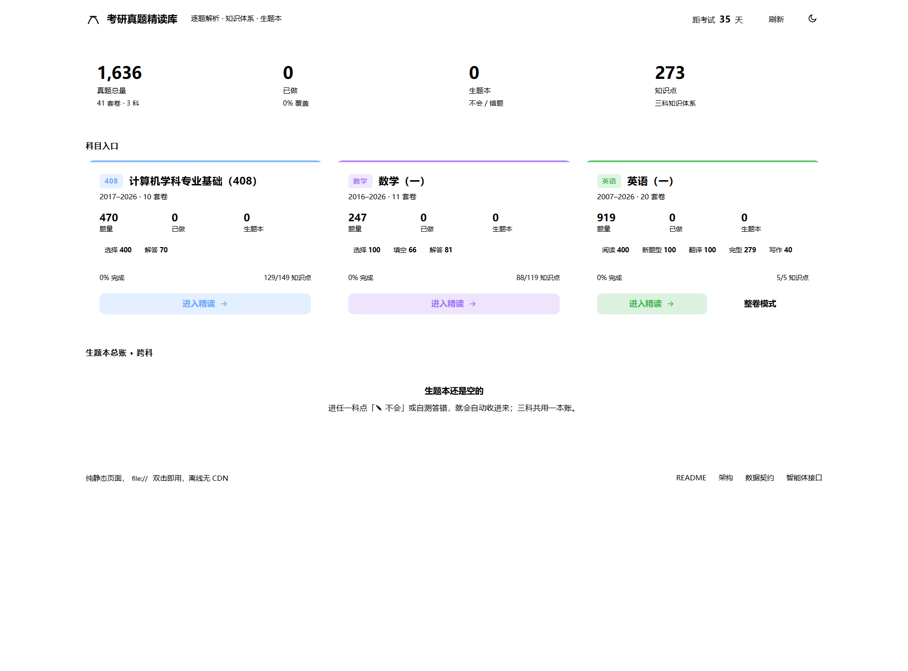
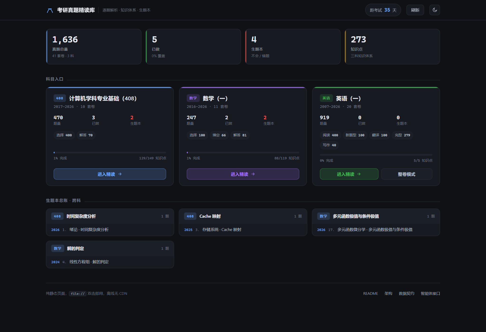

# 考研真题精读库

## 个人学习：自动保存到文件

**请双击根目录 `启动学习库.cmd` 开始学习。** 页面会自动打开；错题、生题本、答题记录、英语生词和本人标记的知识点自动写入 `study-data/`，不再依赖浏览器作为正式存储。已迁入的个人记录也在这里。

- 人直接读：[我的学习档案](study-data/学习档案.md)
- 智能体先读：`node tools/read.mjs learning summary`，再按科读取 `learning 408` / `learning math` / `learning english`
- 完整机器资料：[agent-context.json](study-data/agent-context.json)，正式原始记录：[state.json](study-data/state.json)
- 页面左下角显示保存状态，也可明确标记不会的知识点。详见 [保存、恢复与同步说明](study-data/README.md)。

以下“纯静态 / file://”说明适用于浏览题库；**自动写文件必须通过上述启动入口**。仅需 Node.js 22+，无 npm 安装步骤，可离线使用。

> 英语（一）· 数学（一）· 408 计算机学科专业基础 —— 近十余年真题**逐题解析**、**知识体系**、**生题本**。
> 纯静态页面，`file://` 双击即用，**离线无 CDN**。

一句话：把「做错的题」变成「没掌握的知识点」，再按知识点把十年真题串起来讲透。



生题本总账按「科目 → 知识点」跨科聚合，一屏看完今天该攻哪几个点：



---

## 三科入口

| 科目 | 年份 | 套卷 | 题量 | 入口 |
|---|---|---:|---:|---|
| [408 计算机学科专业基础](subjects/408/index.html) | 2017–2026 | 10 | 470 | `subjects/408/index.html` |
| [数学（一）](subjects/math/index.html) | 2016–2026 | 11 | 247 | `subjects/math/index.html` |
| [英语（一）](subjects/english/index.html) | 2007–2026 | 20 | 919 | `subjects/english/index.html` |

合计 **41 套卷 · 1,636 题 · 273 个知识点**。打开根目录 `index.html` 就是三科总入口。

## 打开方式

个人学习请双击 **`启动学习库.cmd`**，自动打开本机地址并开启文件保存。停止时双击 `停止学习库.cmd`。

双击 `index.html`（Chrome / Edge）只用于静态浏览，不提供自动文件保存。

> 想要「跨页共享进度」，用 `file://` 直接打开即可；若浏览器把每个 `file://` 当独立源，进度只在本页生效 —— 这时用 `python -m http.server 8000` 起个本地服务再访问 `http://localhost:8000` 即可。

## 每科都是同一套四视图

| 视图 | 快捷键 | 内容 |
|---|---|---|
| 试卷 | `1` | 按年份 → 题型 → 学科筛选，逐题精读；右栏是详情 |
| 知识体系 | `2` | 学科 → 模块 → 知识点，点知识点看「十年真题里怎么考」 |
| 生题本 | `3` | 按「学科 → 模块 → 知识点」聚合不会的题，可导出 Markdown / CSV |
| 统计 | `4` | 题量 / 完成度 / 正确率 / 年份×学科矩阵 / 薄弱点 Top15 / 高频点 Top20 |

两个模式：**精读**（解析默认展开）· **自测**（先做再看答案，答错自动进生题本）。

键盘：`1`–`4` 选选项 · `j`/`k` 下一题/上一题 · `a` 解析开关 · `w` 标记不会 · `m` 精读/自测 · `/` 搜索 · `Esc` 关浮层 · `A−`/`A+` 字号

## 复读流程

1. 做题时点「✎ 不会」（或自测答错）→ 进生题本
2. 「生题本」→ **导出 Markdown**
3. 贴给模型 —— 导出格式是**按知识点串讲**：每个知识点先给「十年考过 N 次 + 我的错题清单」，再分
  ① 先讲知识点 ② 十年真题清单（含 `[我不会]` 标记）③ 错题详解，末尾 4 条「请这样教我」
4. 讲完回「知识体系」→ 点该知识点 → 横向看同知识点的其它年份真题

> 算错的题自己复盘（计算失误不需要进生题本）；**知识点 / 模块不清晰**的才进。

## 目录结构

```
真题精读/
├── index.html                    # 总入口：三科卡片 + 跨科总览 + 生题本总账
├── shared/
│   ├── hub.css                   # 总入口样式（自包含设计令牌）
│   ├── hub.js                    # 总入口逻辑（读 manifest + 聚合 localStorage）
│   └── vendor/katex/             # 本地 KaTeX 0.16.11（三科共用一份）
├── subjects/
│   ├── 408/                      # 计算机学科专业基础
│   │   ├── index.html
│   │   ├── README.md  SCHEMA.md
│   │   ├── assets/{style.css, app.css, app.js}
│   │   └── data/{kb.js, paper/*.js, _build/*}
│   ├── math/                     # 数学（一）
│   │   └── …（同上，引用 ../../shared/vendor/katex/）
│   └── english/                  # 英语（一）
│       ├── index.html  paper.html
│       ├── assets/{style.css, app.css?, app.js, paper.css, paper.js}
│       └── data/{paper/*.js, wx/*.js}
├── data/
│   ├── manifest.json             # 机器可读总清单（给智能体）
│   ├── manifest.js               # 同一份内容的页面版（file:// 不能 fetch）
│   └── build-manifest.mjs        # 生成器
├── docs/
│   ├── ARCHITECTURE.md
│   ├── DATA-SCHEMA.md
│   ├── AGENT.md
│   └── screenshots/
├── README.md
└── LICENSE
```

## 校验

```powershell
# 总清单
node data/build-manifest.mjs

# 各科自己的校验器
cd subjects/408    ; node data/_build/validate.mjs
cd subjects/math   ; node data/_build/validate.mjs
```

## 数据规模

| 科目 | 选择题 | 填空题 | 解答/主观题 | 知识点覆盖 |
|---|---:|---:|---:|---|
| 408 | 400 | — | 70 | 129 / 149 |
| 数学（一） | 100 | 66 | 81 | 88 / 119 |
| 英语（一） | 阅读 400 · 新题型 100 · 翻译 100 · 完型 279 · 写作 40 | | | 5 体裁 |

## 素材来源

- **408 / 数学**：历年真题 PDF 与官方详解，逐页 150 DPI 渲染后人工核对重建（原始 PDF 文本层是低质 OCR，不可直接采用）
- **英语**：历年真题 + 生词本 / 完形数据
- 扫描页保留在 `_png/` 外部目录，可随时回查

## License

[MIT](LICENSE)
